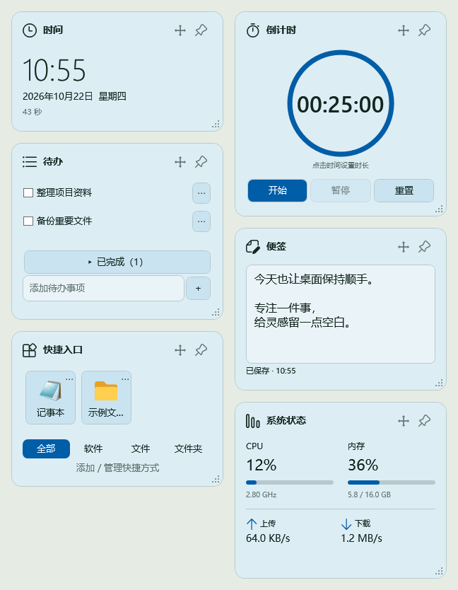
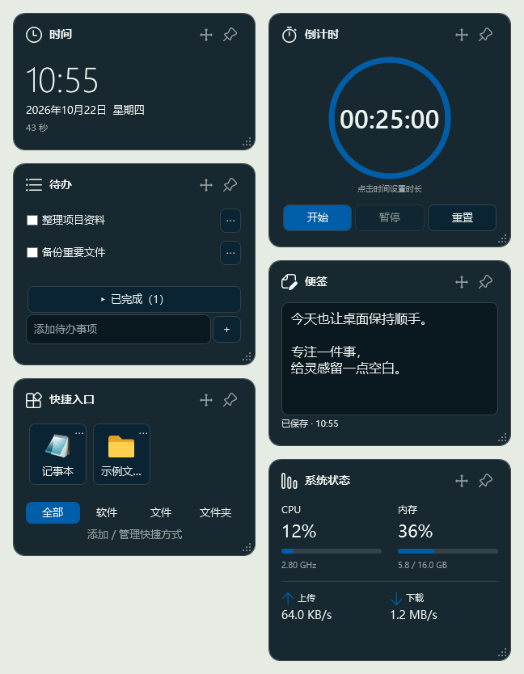
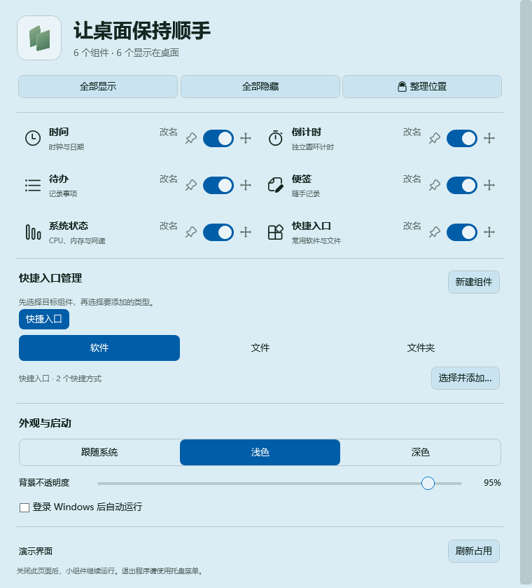
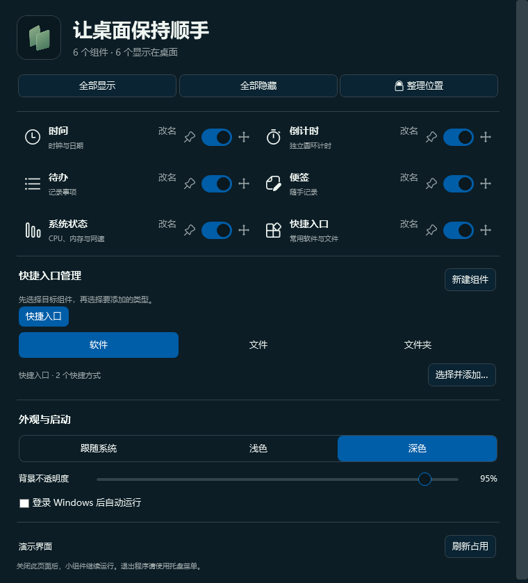

# DeskSprig

让桌面保持顺手。

当前源码版本：**v1.5.0** · 内置多语言。

DeskSprig 是一个支持简体中文、繁體中文与 English 的离线、免安装的 Windows 桌面小组件应用。把时间、倒计时、待办、便签、系统状态和常用入口放在桌面上，通过统一管理页调整显示、布局与外观。

应用使用 C# / WPF 和 .NET Framework 4.8 编写。当前程序内显示名称为“桌面小组件”。

## 界面预览

预览展示初始公开版本的基础布局；v1.5.0 新增的语言选项见下方“界面语言”说明。

以下图片由实际程序的 WPF 控件在隔离演示实例中渲染。便签、待办、快捷入口和系统数值均为展示示例，没有采集个人桌面或正式业务数据。组件总览按两列排版，实际窗口可以自由摆放。

| 浅色组件 | 深色组件 |
| --- | --- |
|  |  |

## 六种桌面组件

### 时间

- 使用 24 小时制显示时间，同时显示日期、星期和秒数。
- 独立显示在桌面上，可以调整位置、尺寸、名称及摆放模式。

### 倒计时

- 独立圆环显示剩余时间，数字统一为 `HH:mm:ss`。
- 支持开始、暂停、继续和重置，时长范围为 `00:00:01–99:59:59`。
- 点击数字打开时、分、秒选择器；可以直接输入、粘贴完整时间，或使用鼠标滚轮、上下方向键与拖动选择。
- 运行中不能修改时长，暂停后可重新设置；确认新时长会回到未开始状态。
- 隐藏组件后仍继续计时，睡眠唤醒后按截止时间校正，到时提示一次并播放系统提示音。
- 退出程序期间不会提醒；再次启动只恢复设置的时长，不会自动继续上次计时。

### 待办

- 在底部输入事项，按回车或点击“＋”添加。
- 勾选完成状态，未完成事项优先显示，已完成事项可折叠收起。
- 每条事项通过“⋯”菜单编辑或删除，适合放置当天需要随时看到的简短任务。
- 内容保存在本地，重新启动后恢复。

### 便签

- 一张持续保存的多行纯文本便签，长内容可以滚动查看。
- 停止输入约 500 毫秒后自动保存，底部显示保存状态。
- 双击托盘图标即可唤出现有便签并聚焦编辑区，不会额外创建新便签。
- 唤出时临时前置，失去焦点后恢复原来的置顶或桌面固定状态；原本隐藏的便签会保持显示。

### 系统状态

- 显示整机 CPU 使用率，以及系统报告的当前逻辑处理器平均频率。
- 显示内存使用率和已用 / 总容量。
- 显示上传、下载速率及短期趋势线，速率单位会随数值调整。
- 可见时约每 2 秒采样，隐藏后暂停采样；首次采样或暂时无法读取时会显示相应状态。
- 数据对应整台电脑的运行状态；管理页底部另有本程序的内存占用信息，可手动刷新。

### 快捷入口

- 为软件、文件和文件夹创建可点击入口，集中放置常用目标。
- 支持新建多个独立快捷入口组件，例如按工作、资料或工具分组；每组独立保存名称、内容、布局、显示状态与摆放模式。
- 在管理页先选择目标组件，再选择“软件 / 文件 / 文件夹”，通过文件选择器添加。
- 组件底部的“全部 / 软件 / 文件 / 文件夹”用于筛选已有条目；“添加 / 管理快捷方式”打开管理页并选中当前组。
- 每个入口通过“⋯”菜单改名、调整顺序或移除。
- 软件和文件显示实际目标图标，文件夹使用内置图标；文件夹还可选择本地 ICO、PNG、JPG 图标或恢复默认。
- 自定义图标会复制到程序数据目录，移动整个应用目录时可一起保留。目标失效或图标不可用时会提示或回退。

## 按自己的习惯摆放

每个组件都有独立窗口，可以拖动标题移动，通过四边、四角或右下角把手调整尺寸。位置、大小和显示状态会保存，重新启动后恢复。

### 三种摆放模式

| 模式 | 移动与缩放 | 内容操作 | 层级行为 |
| --- | --- | --- | --- |
| 自由摆放 | 可以 | 可以 | 可独立设置置顶 |
| 锁定位置与大小 | 禁止 | 可以 | 可独立设置置顶 |
| 固定桌面 | 禁止 | 可以 | 挂接到 Explorer 桌面层，显示桌面后仍可见，普通应用可以覆盖 |

点击组件标题或管理页中的移动、锁、显示器图标，按顺序切换模式。进入固定桌面模式后暂时取消实际置顶，离开时恢复原来的置顶偏好；挂接失败会回到可见的锁定模式并提示。

### 边缘磁吸

- 自由拖动时，靠近其他可见组件边缘或屏幕可用区域边缘约 6 DIP 会吸附，屏幕磁吸会避开任务栏。
- 只移动正在拖动的组件，已锁定组件可以作为吸附目标。
- 已贴边的组件重新拖动时可以直接拉开；离开约 8 DIP 后再次靠近才重新吸附。
- 按住 `Alt` 可以临时跳过磁吸。
- “整理位置”会先询问确认，只整理可见且自由摆放的组件，保留尺寸，并避开锁定或固定桌面的组件。

### 组件改名

双击组件标题、使用标题右键菜单，或点击管理页中的“改名”，均可设置 1–32 字的名称，也可以恢复默认名称。修改会同步到组件、管理页和托盘菜单。

## 统一管理与外观

管理页提供每个组件的显示开关、置顶、摆放模式和改名入口，也可以全部显示、全部隐藏或整理位置。宽窗口使用双列，窄窗口自动切为单列。

| 浅色管理页 | 深色管理页 |
| --- | --- |
|  |  |

- **主题：**跟随系统、浅色、深色三种选择，并使用 Windows 强调色。
- **透明度：**背景不透明度可在 35%–100% 之间调整，文字和操作图标保持清晰；关闭系统透明效果或启用高对比度时采用相应回退。
- **即时更新：**已固定到桌面的组件也会同步响应主题和透明度变化。
- **登录自启：**首次正常运行默认启用，可在管理页或托盘菜单关闭；登录自启时不主动打开管理页。

## 托盘与退出

| 操作 | 行为 |
| --- | --- |
| 单击托盘图标 | 打开管理页；等待系统双击判定时间后执行 |
| 双击托盘图标 | 唤出并聚焦便签，取消待执行的单击动作 |
| 右键托盘图标 | 管理组件显示、主题、透明度、自启及退出 |
| 关闭管理页 | 小组件继续运行 |
| 托盘菜单“退出” | 保存并结束程序 |

组件没有右上角关闭按钮；隐藏由管理页或托盘统一控制。重复启动会恢复已有实例并打开管理页。

## 本地保存与便携使用

内容和设置固定保存在程序旁的 `data` 目录：

| 文件 / 目录 | 内容 |
| --- | --- |
| `business.json` | 待办、便签、快捷入口和倒计时时长 |
| `settings.json` | 主题、透明度、自启、各组件的位置、尺寸、名称、模式与显示状态 |
| `icons` | 自定义文件夹图标副本 |
| `.bak` 文件 | 最近的有效备份 |

保存使用临时文件替换并保留备份。数据目录不可写会明确报错；主文件损坏时尝试有效备份并保留损坏原件，无法恢复时停止启动。

移动或升级前，从托盘退出程序并备份整个 `data`。移动应用时带上完整数据目录；升级只替换程序文件，保留数据。回退旧版本前先保留最新数据副本，具体兼容限制见[使用说明](使用说明.md)。

## 界面语言

在管理页“外观与启动 → 语言”选择 **跟随系统、简体中文、繁體中文或 English**，立即生效并保存选择，无需重启。

- 默认跟随 Windows 显示语言：简体中文地区使用简体，繁体中文（台湾、香港、澳门）使用繁体，其余未支持的语言使用 English。
- 组件默认名称、管理页、托盘操作、应用对话框、提示和日期随语言切换；自定义组件名、便签、待办、快捷入口名称与路径保持原文。
- 运行中的倒计时、编辑器内容与选区、窗口位置和固定桌面状态保留。
- 三种翻译内置于程序，不需要下载或导入语言包。更改 Windows 显示语言可能需要 Windows 注销登录；应用在启动或收到系统偏好通知时重新匹配。

## 构建与运行

环境要求：Windows x64，已安装 .NET Framework 4.8。构建使用系统自带 Framework 编译器，不需要额外安装 .NET SDK、还原 NuGet 包或联网下载依赖。

在项目目录打开 PowerShell：

```powershell
.\build.ps1
.\打开管理页.cmd
```

构建输出位于 `release`。也可以直接运行 `release\桌面小组件.exe`，或使用 `--manage` 参数打开管理页。若本机执行策略限制脚本，请先检查脚本内容并按自己的环境策略处理。

## 验证与兼容性

```powershell
.\tests\verify.ps1
.\tests\languages.ps1
```

验证使用独立测试数据目录，需要交互式 Windows 桌面。部分检查会临时显示窗口、切换桌面或测试自启并恢复原值；运行前请保存正在编辑的内容。

当前已在 Windows 10 上验证。Windows 11、物理多屏与混合 DPI、实际鼠标和输入法组合等仍需进一步实测；自动检查和控件渲染图不能替代这些桌面验收。界面预览中的系统数值仅为示例，不是资源性能测试结果。

个人运行数据与本机生成的验证资料不纳入版本控制。

## 第三方资源

界面静态图标来自 Microsoft Fluent UI System Icons，许可见[第三方许可](第三方许可.md)及 `assets/icons/LICENSE`。
